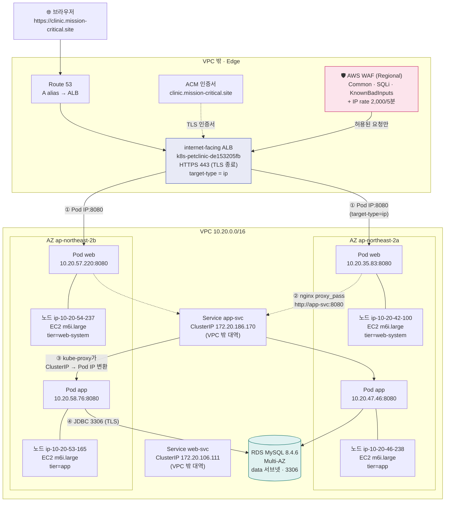

# 5일 완성 — 내 EKS 아키텍처 흐름 (EC2 3-tier에서 출발)

> 대상: **EC2 기반 3-tier는 완벽히 이해하지만 Docker/Kubernetes는 처음**인 사람
> 목표: 5일 뒤 **"브라우저 요청 한 건이 어디를 지나 어디에 도착하는지"를 백지에 그릴 수 있게** 된다
> 실제 대상: 이 저장소로 구축한 `petclinic-dev` 클러스터 (ap-northeast-2, EKS 1.34)

---

## 0. 진단 — 왜 헷갈리는가

EC2 3-tier에서 당신이 가진 모델은 이것입니다.

```text
인스턴스 1대 = 앱 1개 = 하나의 주소
"어느 인스턴스에 내 앱이 있나?" → 인스턴스 목록을 보면 안다
```

EKS에서는 이 등식이 **깨집니다.**

```text
노드 1대 = 앱 여러 개(Pod)
앱 1개(Pod) = 노드 여러 대에 흩어져 있음
"어느 노드에 내 앱이 있나?" → 물어봐도 소용없다. 계속 바뀐다
```

그래서 EC2 사고방식으로 EKS를 보면 **"내 앱이 어디 있지?"** 에서 막힙니다.
EKS의 답은 위치가 아니라 **선언**입니다.

> "나는 `app` 이라는 앱을 **2개** 원한다. 어디에 놓을지는 네가 정해라."
> — Deployment 매니페스트에 이 한 줄을 쓰면, Kubernetes가 노드를 고르고, 죽으면 다시 만들고, 늘려달라면 늘린다.

**5일 계획의 핵심 전략**: 새로운 개념 200개를 외우는 게 아니라,
**"EC2에서 하던 일을 누가 대신하는가"** 를 하나씩 짝지어 가는 것입니다.

---

## 1. 한 장 요약 — 요청 하나의 여행

### 1.1 전체 경로



### 1.2 단계별로 "EC2에서는 / 여기서는"

| # | 무슨 일이 일어나는가 | EC2 3-tier에서는 | 여기서는 |
|---|---|---|---|
| 0 | 도메인 이름을 IP로 바꾼다 | Route 53 → ALB | **동일** (변경 없음) |
| 1 | TLS를 푼다 | ALB에서 종료 | **동일** (ACM 인증서를 ALB에 연결) |
| 2 | 악성 요청을 거른다 | (없었거나 WAF를 ALB에 붙임) | **AWS WAF** 가 ALB 앞에서 검사 |
| 3 | 어느 백엔드로 보낼지 고른다 | ALB **Target Group** → **EC2 인스턴스 ID:8080** | ALB Target Group → **Pod IP:8080** |
| 4 | 1차 앱(리버스 프록시)에 도착 | EC2 안의 nginx 프로세스 | **Pod(web)** 안의 nginx 컨테이너 |
| 5 | 2차 앱(WAS)을 찾아간다 | nginx가 `was.internal:8080` 같은 **고정 주소**로 | nginx가 `app-svc:8080` — **Service 이름**으로 |
| 6 | 실제 WAS에 도착 | 그 EC2 인스턴스 | **Pod(app)** — 어느 노드인지는 매번 다를 수 있음 |
| 7 | DB 접속 | JDBC → RDS | **동일** (Pod IP가 VPC IP라서 그대로 라우팅됨) |

**3번이 이 아키텍처의 심장입니다.** EC2에서는 ALB가 **인스턴스**를 등록했는데,
여기서는 ALB가 **Pod IP**를 등록합니다. 그러려면 Pod IP가 **VPC 안에서 실제로 라우팅되는 IP**여야 합니다.
그게 바로 이 클러스터의 **VPC CNI** 가 하는 일입니다 (Day 3).

**5번이 두 번째 심장입니다.** nginx는 `app-svc` 라는 **이름**만 알고, 그 뒤에 Pod가 몇 개인지, 어느 노드에 있는지 모릅니다.
이름을 IP로 바꾸고 부하를 나누는 일은 **Service** 가 합니다 (Day 4).


### 1.3 이 그림이 맞는지 실제로 확인한 값 (실측)

| 확인한 것 | 결과 |
|---|---|
| 노드 4대 | `ip-10-20-42-100`(AZ-a, web-system), `ip-10-20-46-238`(AZ-a, app), `ip-10-20-53-165`(AZ-b, app), `ip-10-20-54-237`(AZ-b, web-system) — 전부 `m6i.large`, **taint 없음** |
| web Pod 2개 | `10.20.35.83` (노드 42-100), `10.20.57.220` (노드 54-237) |
| app Pod 2개 | `10.20.47.46` (노드 46-238), `10.20.58.76` (노드 53-165) |
| `web-svc` ClusterIP | `172.20.106.111` → endpoints `10.20.35.83:8080`, `10.20.57.220:8080` |
| `app-svc` ClusterIP | `172.20.186.170` → endpoints `10.20.47.46:8080`, `10.20.58.76:8080` |
| ALB target | `10.20.35.83:8080` healthy, `10.20.57.220:8080` healthy → **Pod IP 등록 확정** (`target-type: ip`) |
| **Pod IP = 노드 ENI 보조 IP** | **4/4 일치** — 노드 42-100 의 ENI 에 `10.20.35.83`, 46-238 에 `10.20.47.46`, 53-165 에 `10.20.58.76`, 54-237 에 `10.20.57.220` 존재 |
| CNI 설정 | `ENABLE_PREFIX_DELEGATION=false`, `ENABLE_POD_ENI=false` → 노드와 **같은 서브넷**에서 `/32` 보조 IP 를 개별 할당 |
| 노드 Pod 수용량 | `capacity pods: 29` = 3 ENI × (10 IP − 1) + 2 |
| hostNetwork Pod | `aws-node`, `kube-proxy`, `eks-pod-identity-agent` 의 IP = **노드 IP 와 동일** |

> **여기서 얻어야 하는 결정적 통찰 2개**
>
> 1. **ClusterIP(`172.20.x.x`)는 VPC 대역(`10.20.0.0/16`) 밖이다.** 즉 실제 IP 가 아니다.
>    VPC 라우팅 테이블에도, ENI 에도 없다. `10.20.x.x`(Pod IP)는 VPC 가 라우팅하지만
>    `172.20.x.x`(ClusterIP)는 **노드 안의 iptables 규칙으로만** 존재한다.
> 2. **노드와 Pod 가 같은 서브넷을 쓴다.** 그래서 ALB → Pod IP 가 VPC 라우팅만으로 도달한다.
>    온프렘 overlay(Calico) 방식이었다면 Pod IP 가 노드 밖에서 보이지 않아 이 구조가 불가능했다.
---

## 2. EC2 → Kubernetes 번역표 (이 프로젝트 실제 값)

| EC2 3-tier에서 쓰던 것 | Kubernetes / EKS 에서 대응하는 것 | 이 프로젝트의 실제 값 |
|---|---|---|
| **AMI** (앱+OS를 구워둔 이미지) | **컨테이너 이미지** (OCI 이미지) | ECR `petclinic-app:1.0.6`, `petclinic-web:1.0.0` |
| **EC2 인스턴스** | **노드** — *여전히 EC2 인스턴스다* | `ip-10-20-42-100` 외 4대, `m6i.large`, AL2023 |
| 인스턴스에서 도는 **프로세스**(tomcat, nginx) | **컨테이너** | app 컨테이너(Tomcat 11 + JDK21), web 컨테이너(nginx 1.29) |
| (대응 없음) | **Pod** = 컨테이너 + 네트워크 + 볼륨을 묶은 **최소 배포 단위** | `app-5f9d78d955-cpbpz`, `web-b7bfb764d-9nhch` … |
| **systemd** 유닛 (프로세스 관리) | **kubelet** 이 컨테이너를 직접 관리 | 노드마다 kubelet, 컨테이너 런타임은 containerd |
| **user-data** 스크립트 | **Dockerfile** 의 `RUN` + `ENTRYPOINT` | `app/Dockerfile`, `app/entrypoint.sh` |
| `/etc/my.cnf`, `/etc/app.properties` | **ConfigMap / Secret** → 볼륨으로 마운트 | Secret `app-config` → `/etc/petclinic/data-access.properties` |
| **Auto Scaling Group** (desired 2) | **Deployment `replicas: 2`** (+ ReplicaSet) | `deploy/app` 2, `deploy/web` 2 |
| ASG **롤링 업데이트** | Deployment `strategy: RollingUpdate` | `maxUnavailable: 0`, `maxSurge: 1` |
| **ALB Target Group** (인스턴스 ID 등록) | **Service + TargetGroupBinding** (Pod IP 등록) | `target-type: ip`, LBC가 자동 생성 |
| **ALB Listener Rule** | **Ingress** (AWS Load Balancer Controller가 해석) | `ingress/petclinic-web` |
| **보안그룹** (인스턴스 ENI에 부착) | **노드** SG에 부착 (+ NetworkPolicy는 별개) | `web-node-sg`, `app-node-sg`, `alb-sg`, `rds-sg` |
| **IAM Role → 인스턴스 프로파일** | **IRSA** — ServiceAccount에 Role ARN을 주석 | `serviceAccountName: petclinic-app` + `eks.amazonaws.com/role-arn` |
| 인스턴스의 **내부 IP** | **Pod IP** = 노드 ENI의 **보조 IP** (VPC CNI) | `10.20.35.83`, `10.20.47.46`, `10.20.57.220`, `10.20.58.76` |
| 인스턴스에 **SSH/SSM** 으로 들어가서 확인 | `kubectl logs` / `kubectl exec` / `kubectl describe` | 노드에 들어갈 필요가 없음 |
| **Launch Template** | **Launch Template** (Managed Node Group도 씀) | `petclinic-dev-web-system-*`, `petclinic-dev-app-*` |
| ASG **인스턴스 타입** | 노드그룹 `instance_types` | `m6i.large` (web-system 2대, app 2대) |
| **배치 그룹 / AZ 분산** | `topologySpreadConstraints` | zone·hostname 기준 `maxSkew: 1` |

### 번역표에서 꼭 기억할 4가지

1. **노드는 여전히 EC2다.** 두렵지 않다. 당신이 아는 그 인스턴스다.
2. **Pod는 인스턴스가 아니다.** "컨테이너 여러 개 + 전용 IP + 볼륨"을 묶은 **논리적 단위**다. 그래서 언제든 죽고 다시 태어난다.
3. **Pod IP가 VPC IP다.** 이 클러스터는 overlay 네트워크(Calico/Flannel)를 쓰지 않고 **ENI 보조 IP**를 쓴다. 그래서 ALB가 Pod를 직접 target으로 등록할 수 있다.
4. **Service의 ClusterIP는 실체가 없다.** ping도 안 되고 ENI도 없다. `kube-proxy` 가 iptables 규칙으로 **가로채서** 실제 Pod IP로 바꿔준다.

---

## 3. 5일 계획 — 개요

| Day | 주제 (한 문장) | 핵심 질문 | 읽을 기존 페이지 | 예상 시간 |
|---|---|---|---|---|
| **1** | **컨테이너 = "인스턴스 없이 앱을 포장하는 법"** | AMI와 이미지는 무엇이 같고 무엇이 다른가? | Docker `05`,`08`,`09`,`10`,`11`,`14`,`15` | 2.5h |
| **2** | **노드 = EC2, Pod = 프로세스** | 내 앱은 어느 노드에 있고, 왜 계속 바뀌는가? | K8s `01`,`07`,`10`,`11`,`18` | 3h |
| **3** | **Pod IP는 어디서 오는가 (VPC CNI)** | Pod IP가 VPC IP라는 게 왜 중요한가? | K8s `03`,`19`(대비),`17` | 3h |
| **4** | **Service·Ingress — ALB가 Pod를 어떻게 찾나** | ClusterIP는 실체가 없는데 어떻게 동작하나? | K8s `06`,`20`,`22`,`23`,`21`(대비) | 3h |
| **5** | **운영 — 배포·확장·설정·권한 + 전체 재조립** | 롤링 배포·스케일·설정 주입·IAM을 어떻게 하나? | K8s `09`,`12`,`13`,`15`,`16`,`25`,`26`,`14` | 3.5h |

**하루 진행 방식 (고정)**

1. **읽기 (40분)** — 아래 "읽을 페이지" 링크를 순서대로
2. **직접 확인 (60~90분)** — 아래 명령을 **직접 실행**하고 출력을 눈으로 본다
3. **셀프 체크 (20분)** — 아래 질문에 **말로** 답한다. 막히면 그 부분만 다시
4. **기록 (10분)** — 이 페이지 아래 "오늘 막힌 것" 에 한 줄

> ⚠️ 명령을 복사만 하지 말고, **`-o wide` 를 붙였다 떼보고** 출력이 어떻게 달라지는지 보세요.
> 그게 실제로 이해되는 지점입니다.

---

## Day 1 — 컨테이너: "인스턴스 없이 앱을 포장하는 법"

### 목표
`Dockerfile` 한 장을 읽고 **"이게 EC2의 AMI + user-data + systemd를 합친 것"** 이라고 설명할 수 있다.

### 왜 이게 먼저인가
EC2에서는 앱을 배포하려면 **인스턴스를 새로 굽고(AMI), 부팅 스크립트(user-data)로 설정하고, systemd로 띄웠습니다.**
컨테이너는 이 세 가지를 **파일 하나(Dockerfile)** 로 합칩니다. Kubernetes는 이 포장된 결과물을 **실행만** 합니다.

### 읽을 페이지
- Docker `05. Docker 이미지` — 이미지와 컨테이너의 관계
- Docker `08. Docker Multi-stage Build`, `09. 멀티스테이지 빌드 정리` — **우리 `app/Dockerfile` 이 왜 단순한지** 비교
- Docker `10. Docker Registry, Repository`, `11. 로그인, 태깅, 푸쉬` — ECR이 무엇인지
- Docker `14. Docker Storage`, `15. 볼륨 마운트` — 컨테이너는 상태를 안 갖는다 → 볼륨/Secret이 필요한 이유

### 직접 해보기

```bash
# 1) 우리가 만든 이미지의 "설계도"를 읽는다 (EC2의 AMI 상세보기와 같다)
cat EKS_Project/app/Dockerfile
cat EKS_Project/app/entrypoint.sh

# 2) 실제 이미지를 내려서 뜯어본다 (ECR 로그인 후)
aws ecr get-login-password --region ap-northeast-2 --profile kdt5 \
  | docker login --username AWS --password-stdin 123456789012.dkr.ecr.ap-northeast-2.amazonaws.com

docker pull 123456789012.dkr.ecr.ap-northeast-2.amazonaws.com/petclinic-web:1.0.0
docker image inspect 123456789012.dkr.ecr.ap-northeast-2.amazonaws.com/petclinic-web:1.0.0 \
  | grep -E '"User"|"ExposedPorts"|"Cmd"|"Entrypoint"'

# 3) 컨테이너를 직접 띄워서 "인스턴스 없이 앱이 돈다"를 눈으로 확인
docker run --rm -d --name t -p 18080:8080 \
  123456789012.dkr.ecr.ap-northeast-2.amazonaws.com/petclinic-web:1.0.0
curl -s -o /dev/null -w "8080 업무포트: %{http_code}\n" http://localhost:18080/        # 404 (업무포트에 health 없음)
curl -s -o /dev/null -w "8081 헬스포트: %{http_code}\n" http://localhost:18081/health/ready  # 200 ok
docker rm -f t

# 4) 이미지 안에 무엇이 들었는지 (EC2에 들어가 ls 하는 것과 같다)
docker run --rm --entrypoint sh \
  123456789012.dkr.ecr.ap-northeast-2.amazonaws.com/petclinic-app:1.0.6 \
  -c 'id; ls -l /usr/local/tomcat/webapps/; head -20 /usr/local/bin/entrypoint.sh'
```

### 셀프 체크 (말로 답해보세요)
1. AMI와 컨테이너 이미지는 무엇이 같고 무엇이 다른가?
2. `user-data` 는 `Dockerfile` 의 어느 부분에 해당하나?
3. 우리 `app/Dockerfile` 은 multi-stage를 **쓰지 않는다**. 왜 그런가? (힌트: 빌드가 이미 끝난 WAR를 복사한다)
4. 컨테이너는 왜 `USER 10001` 로 도는가? EC2에서 root로 돌리지 않는 것과 같은 이유인가?
5. `entrypoint.sh` 가 설정 파일이 없으면 **일부러 죽는** 이유는?
6. 컨테이너가 상태를 갖지 않는다면, 톰캣의 `work/` `logs/` 는 어디에 쓰나?

### 함정
- **컨테이너 안에서 `localhost` 는 컨테이너 자신**입니다. EC2에서 `localhost:3306` 이 되던 게 안 됩니다 → Day 4의 Service가 필요한 이유.
- 이미지 태그 `latest` 는 쓰지 않습니다. 우리는 `1.0.6` 처럼 **고정 태그**를 씁니다 (ECR이 IMMUTABLE).

---

## Day 2 — 노드 = EC2, Pod = 프로세스

### 목표
`kubectl get nodes` / `get pods -o wide` 를 보고 **"EC2 인스턴스 4대 위에 컨테이너 4개가 흩어져 있다"** 를 그림으로 그릴 수 있다.

### 왜 헷갈리는가
EC2 3-tier에서는 **인스턴스 = 앱**이었습니다. 여기서는 **노드 1대에 여러 Pod**가 올라가고,
같은 앱의 Pod 2개가 **다른 노드**에 흩어집니다. 그 이유는 **장애 격리**입니다 (EC2에서 AZ 2개에 인스턴스를 나눈 것과 같은 목적).

### 읽을 페이지
- K8s `01. 쿠버네티스 기본 개념` — **선언적 상태(desired state)** 가 전부다
- K8s `18. 컨트롤 vs 데이터 플레인` — 누가 명령을 내리고 누가 실행하나
- K8s `07. 이론: 파드관리` — Pod / ReplicaSet / Deployment 의 관계
- K8s `10. 매니페스트 kind 정리` — 우리 yaml의 `kind:` 들이 각각 무엇인지
- K8s `11. 이론: 노드관리` — 노드가 죽으면 무슨 일이 일어나나

### 직접 해보기

```bash
export KUBECONFIG=<SSM 포트포워딩 후 만든 kubeconfig>

# 1) 노드 4대 = EC2 인스턴스 4대 (여기가 EC2와 이어지는 지점)
kubectl get nodes -o wide
kubectl describe node ip-10-20-42-100.ap-northeast-2.compute.internal \
  | grep -E "Instance Type|Zone|InternalIP|pods:|cpu:|memory:|nodegroup"

# 2) 노드에 붙은 라벨이 "어느 노드그룹인지"를 말해준다
kubectl get nodes -L eks.amazonaws.com/nodegroup -L tier -L topology.kubernetes.io/zone

# 3) Pod가 어느 노드에 있는지 (Pod IP까지)
kubectl -n petclinic-dev get pods -o wide

# 4) Pod 하나를 해부한다 (EC2 describe-instances 와 비교해보세요)
kubectl -n petclinic-dev describe pod -l app.kubernetes.io/component=app -o wide | head -60

# 5) Deployment / ReplicaSet / Pod 3층 구조
kubectl -n petclinic-dev get deploy,rs,pod -o wide

# 6) "누가 이 Pod를 어느 노드에 놓았나" — 이벤트를 본다
kubectl -n petclinic-dev get events --sort-by=.lastTimestamp | grep -i schedul | tail -5

# 7) Pod 하나를 지워본다 → 새 Pod가 "다른 IP로" 다시 태어난다
kubectl -n petclinic-dev get pods -o wide | grep app
kubectl -n petclinic-dev delete pod <app-pod-하나>
kubectl -n petclinic-dev get pods -o wide -w     # 새 이름·새 IP로 다시 뜨는 것을 본다
```

### 셀프 체크
1. 노드 1대에는 CPU/메모리가 얼마나 있고, Pod를 몇 개까지 올릴 수 있나? (`describe node` 의 `Allocatable`)
2. Pod 2개가 **다른 노드**에 흩어지게 만드는 설정은 어디에 있나? (힌트: `topologySpreadConstraints`)
3. web Pod는 왜 app 노드에 안 가고 web-system 노드에만 가나? (힌트: `nodeSelector`)
4. 이 클러스터는 노드그룹에 **taint를 걸지 않았다**. 그럼에도 Pod가 섞이지 않는 이유는?
5. Pod를 지웠을 때 **누가** 새 Pod를 만들라고 지시했나? (Deployment → ReplicaSet → Pod)
6. 새로 뜬 Pod의 **IP가 바뀌었다.** 그러면 ALB는 어떻게 따라가나? (Day 4의 답)
7. `kubectl get deploy` 의 `READY 2/2` 에서 앞의 2와 뒤의 2는 각각 무엇인가?

### 함정
- **Pod를 직접 만들지 않습니다.** Pod를 직접 만들면 죽었을 때 아무도 다시 안 만들어줍니다. Deployment가 그 역할입니다 (EC2에서 ASG가 인스턴스를 다시 만드는 것과 같음).
- **`kubectl get pods` 의 AGE가 짧다고 문제가 아닙니다.** 선언한 상태로 수렴하는 정상 동작입니다.

---

## Day 3 — Pod IP는 어디서 오는가 (VPC CNI) ★ 이 아키텍처의 심장

### 목표
**"Pod IP가 노드 ENI의 보조 IP"** 라는 것을 실제 데이터로 확인하고, 그래서 **ALB가 Pod를 직접 target으로 등록할 수 있다** 는 결론에 도달한다.

### 왜 이게 결정적인가
일반적인 Kubernetes(온프렘)에서는 Pod 네트워크가 **overlay**입니다. Pod IP는 노드 밖에서 보이지 않습니다.
그래서 외부에서 Pod로 직접 못 갑니다 → 반드시 NodePort/Ingress 컨트롤러를 거쳐야 합니다.

**EKS의 VPC CNI는 다릅니다.** Pod에 **VPC 서브넷의 실제 IP**를 줍니다 (노드 ENI에 보조 IP를 붙여서).
그래서 이 아키텍처에서는:

```text
ALB → (VPC 라우팅 그대로) → Pod IP      ← 중간에 아무것도 없다
```

EC2 3-tier에서 ALB가 인스턴스에 직접 갔던 것과 **정확히 같은 방식**입니다. 대상만 인스턴스 → Pod로 바뀐 것.

### 읽을 페이지
- K8s `03. CRI/CNI/CSI/CRD/OCI` — CNI가 무엇인지 (플러그인 인터페이스)
- K8s `19. kubeadm init : Calico 192.168.0.0/16` — **대비용**. 온프렘은 overlay(Calico)를 쓴다
- K8s `17. PV · PVC · StorageClass` — 같은 "플러그인" 계열인 CSI (EBS).
  **참고: 이 클러스터에는 PV/PVC 가 0개다.** 앱이 상태를 갖지 않아 `emptyDir` + Secret 만 쓰기 때문이다.
  "왜 우리는 영속 볼륨이 필요 없는가"를 설명할 수 있으면 CSI 를 이해한 것이다.

### 직접 해보기

```bash
# 1) 이 클러스터의 CNI는 무엇인가
kubectl -n kube-system get ds aws-node -o wide
kubectl -n kube-system get ds aws-node -o yaml | grep -A2 -E "ENABLE_POD_ENHANCED|ENABLE_PREFIX|AWS_VPC_K8S_CNI"

# 2) Pod IP 대역이 어느 서브넷인지 확인
kubectl -n petclinic-dev get pods -o wide
#   예: 10.20.35.83 / 10.20.47.46  → 10.20.32.0/20 (workload AZ-a)
#       10.20.57.220 / 10.20.58.76 → 10.20.48.0/20 (workload AZ-b)

# 3) ★ 결정적 증거: 노드 ENI의 보조 IP 목록에 Pod IP가 들어있는가
NODE_IP=10.20.42.100        # 위에서 본 노드 내부 IP 중 하나
ENI=$(aws ec2 describe-instances --profile kdt5 --region ap-northeast-2 \
  --filters "Name=private-ip-address,Values=$NODE_IP" \
  --query 'Reservations[].Instances[].NetworkInterfaces[].NetworkInterfaceId' --output text)
echo "노드 $NODE_IP 의 ENI = $ENI"

aws ec2 describe-network-interfaces --profile kdt5 --region ap-northeast-2 \
  --network-interface-ids "$ENI" \
  --query 'NetworkInterfaces[].PrivateIpAddresses[].PrivateIpAddress' --output text | tr '\t' '\n' | sort -V

#   → 이 목록 안에 그 노드에서 도는 Pod 의 IP 가 있어야 한다.
#     (없으면 ENI 가 여러 개다: describe-instances 로 그 노드의 ENI 를 전부 조회)
#
#   실측 결과 (이 클러스터): 4/4 일치
#     노드 10.20.42.100 (eni-02c02057c8bdfee1b) 에 10.20.35.83  ← web Pod
#     노드 10.20.46.238 (eni-09a60924135cbdf9e) 에 10.20.47.46  ← app Pod
#     노드 10.20.53.165 (eni-07fda3b3e8be92d21) 에 10.20.58.76  ← app Pod
#     노드 10.20.54.237 (eni-07b9fc1f889058a09) 에 10.20.57.220  ← web Pod
#   → Pod IP 가 노드 ENI 의 보조 private IP 라는 것이 확정됐다.

# 4) Pod 안에서 본 라우팅과 바깥에서 본 라우팅이 같은지
kubectl -n petclinic-dev exec deploy/web -- ip addr show eth0 2>/dev/null || \
  kubectl -n petclinic-dev exec deploy/web -- cat /proc/net/fib_trie | head -20

# 5) Pod IP 로 VPC 안에서 직접 접속된다 (overlay 였다면 불가능)
#    관리 EC2(SSM)에서 시도
aws ssm start-session --target i-03a9f4499e743840d --profile kdt5   # 대화형
#   $ curl -s -o /dev/null -w "%{http_code}\n" http://10.20.35.83:8081/health/ready
#   → 200 이면 Pod IP 가 VPC 에서 라우팅되는 실제 IP 라는 증거
```

### 셀프 체크
1. Pod IP는 어느 서브넷에서 오나? 노드와 같은 서브넷인가?
2. overlay(Calico)를 썼다면 **ALB가 Pod를 target으로 등록할 수 있었을까?**
3. 노드 1대에 Pod IP를 몇 개까지 붙일 수 있나? (`m6i.large` 의 ENI/IP 한도)
4. 노드가 죽으면 그 위의 Pod IP들은 어떻게 되나? Service는 어떻게 되나?
5. Pod IP가 부족해지면 무슨 일이 생기나? (ENABLE_PREFIX_DELEGATION 이 관련)
6. CNI는 "네트워크 플러그인"인데, 그럼 **CRI** 와 **CSI** 는 각각 무엇을 담당하나?

### 함정
- **Pod IP는 영구적이지 않습니다.** Pod가 다시 뜨면 IP가 바뀝니다. 그래서 **IP를 직접 참조하면 안 되고** Service/Endpoints를 통해서만 접근합니다. (단, ALB TargetGroupBinding은 LBC가 자동으로 갱신해줍니다 — Day 4)
- 온프렘 교재의 Calico/Pod CIDR 이야기와 **섞이지 않게** 주의하세요. 우리는 ENI 모드입니다.

---

## Day 4 — Service · Ingress: ALB가 Pod를 어떻게 찾는가

### 목표
`ClusterIP` 가 **실체 없는 가상 IP** 라는 것을 이해하고, ALB가 Pod IP를 어떻게 따라가는지 설명할 수 있다.

### 두 개의 다른 문제
1. **Pod → Pod** : nginx가 `app-svc` 를 찾아야 한다. Pod IP는 계속 바뀐다 → **Service** 가 해결
2. **ALB → Pod** : ALB가 target을 Pod IP로 등록한다. Pod가 바뀌면? → **TargetGroupBinding**(LBC가 자동)

### 읽을 페이지
- K8s `06. Service 유형 — ClusterIP · NodePort · LoadBalancer` — **"type: LoadBalancer 를 쓴다고 K8s가 로드밸런서를 만들어주는 게 아니다"** 가 핵심
- K8s `20. 포트 체계 — containerPort · Service · Gateway API` — 우리는 `containerPort:8080` / Service `8080` / targetPort `http` 를 쓴다
- K8s `22. Ingress — L7 HTTP 라우팅`
- K8s `23. AWS Load Balancer Controller — EKS ALB` — **우리 Ingress를 읽고 ALB를 만드는 주체**
- K8s `21. MetalLB — 온프렘 LoadBalancer IP 발급` — **대비용**. 온프렘은 L4 IP를 직접 발급하지만 EKS는 LBC가 AWS ALB를 만든다

### 직접 해보기

```bash
# 1) Service 와 그 뒤의 실제 Pod IP (Endpoints)
kubectl -n petclinic-dev get svc,endpoints -o wide
kubectl -n petclinic-dev get endpointslices -o wide

# 2) ClusterIP 는 실체가 없다 — 이 IP 를 가진 네트워크 인터페이스가 없다
kubectl -n petclinic-dev get svc app-svc -o jsonpath='{.spec.clusterIP}{"\n"}'
aws ec2 describe-network-interfaces --profile kdt5 --region ap-northeast-2 \
  --filters "Name=addresses.private-ip-address,Values=<위 clusterIP>" --query 'length(NetworkInterfaces)'
#   → 0 이면 "실체 없음" 확인

# 3) 그래서 누가 바꿔주나 — kube-proxy 의 iptables 규칙
kubectl -n kube-system get ds kube-proxy -o wide
#   (노드에 들어갈 수 있으면) iptables -t nat -L KUBE-SERVICES -n | grep <clusterIP>

# 4) Service 이름이 어떻게 풀리나 — CoreDNS
kubectl -n kube-system get deploy coredns
kubectl -n petclinic-dev exec deploy/web -- cat /etc/resolv.conf
kubectl -n petclinic-dev exec deploy/web -- nslookup app-svc.petclinic-dev.svc.cluster.local

# 5) ★ ALB → Pod 로 가는 연결을 누가 만들었나 (LBC)
kubectl -n petclinic-dev get ingress petclinic-web -o yaml
kubectl -n petclinic-dev get targetgroupbinding -o yaml
kubectl -n petclinic-dev get targetgroupbinding -o jsonpath='{range .items[*]}{.spec.targetType}{"  "}{.spec.targetGroupARN}{"\n"}{end}'

# 6) AWS 쪽에서 target 이 Pod IP 인지 확인
TG=$(aws elbv2 describe-target-groups --profile kdt5 --region ap-northeast-2 \
  --query "TargetGroups[?contains(LoadBalancerArns[0],'k8s-petclinic')].TargetGroupArn | [0]" --output text)
aws elbv2 describe-target-health --profile kdt5 --region ap-northeast-2 --target-group-arn "$TG" \
  --query 'TargetHealthDescriptions[].[Target.Id,Target.Port,TargetHealth.State]' --output table
#   → Target.Id 가 Pod IP 와 일치하면 target-type=ip 확정

# 7) Pod 를 지워서 ALB target 이 자동으로 갱신되는지 본다
kubectl -n petclinic-dev delete pod <web-pod>
sleep 30
aws elbv2 describe-target-health --profile kdt5 --region ap-northeast-2 --target-group-arn "$TG" \
  --query 'TargetHealthDescriptions[].[Target.Id,TargetHealth.State]' --output table
```

### 셀프 체크
1. ClusterIP 는 ping 이 되나? 왜 안 되나?
2. nginx 의 `proxy_pass http://app-svc.petclinic-dev.svc.cluster.local:8080` 에서 각 조각의 의미는?
3. `web-svc` 는 누가 쓰나? (힌트: Pod → Pod 통신인가, ALB → Pod 인가)
4. ALB Target Group 에 등록되는 대상은 Pod IP 인가 노드 IP 인가? 그걸 결정하는 값은?
5. Pod 가 새 IP 로 다시 떴을 때 **누가** ALB target 을 갱신하나?
6. Ingress 는 그 자체로 동작하나? 무엇이 있어야 동작하나? (컨트롤러 = LBC)
7. 온프렘에서 `type: LoadBalancer` 를 쓰면 무슨 일이 생기나? (MetalLB 가 없으면?)
8. 우리 Ingress 에 `wafv2-acl-arn` 주석이 있다. WAF 는 Terraform 이 만들고, ALB 는 누가 만드나? 연결은 누가 하나?

### 함정
- **ClusterIP 로는 클러스터 밖에서 접근할 수 없습니다.** (VPC 밖에서도, 심지어 관리 EC2에서도 라우팅되지 않습니다 — 실제 IP가 아니라 iptables 규칙이기 때문)
- **Service 의 selector 와 Pod 의 label 이 안 맞으면 Endpoints 가 비어 502** 가 납니다. EC2에서 Target Group이 unhealthy 인 것과 같은 증상, 다른 원인입니다.
- `port` 와 `targetPort` 를 헷갈리지 마세요. `port` = Service 가 여는 포트, `targetPort` = Pod 의 포트.

---

## Day 5 — 운영: 배포·확장·설정·권한 + 전체 재조립

### 목표
"EC2에서 ASG/AMI/IAM/설정관리로 하던 일을 EKS에서 무엇으로 하는가"를 한 표로 말할 수 있고,
**Day 1~4를 합쳐 전체 요청 경로를 백지에 그릴 수 있다.**

### 읽을 페이지
- K8s `09. Probe 3종` — **우리는 startup/readiness/liveness 를 각각 다르게 쓴다**
- K8s `12. Rollout / top`, `32. 롤링 업데이트 실습` — 무중단 배포
- K8s `13. 오토스케일링 Deployment + HPA` — ASG ↔ HPA/CA 매핑
- K8s `15. 라벨 vs taint` — **우리는 라벨(nodeSelector)만 쓴다**
- K8s `16. ConfigMap · Secret · Volume` — 설정 주입
- K8s `25. HA 엔드포인트`, `26. Helm` — LBC/metrics-server 를 Helm으로 설치한 이유
- K8s `14. 쿠버네티스 실무 질문 정리` — 마무리 점검

### 직접 해보기

```bash
# 1) 무중단 롤링 배포를 관찰한다 (EC2 AMI 롤링과 비교)
kubectl -n petclinic-dev rollout restart deploy/app
kubectl -n petclinic-dev rollout status deploy/app
kubectl -n petclinic-dev get pods -o wide -w      # 새 Pod 가 뜨고 옛 Pod 가 사라지는 순서

# 2) 롤백 (EC2 에서는 불가능했던 것)
kubectl -n petclinic-dev rollout history deploy/app
kubectl -n petclinic-dev rollout undo deploy/app

# 3) Probe 가 실제로 일하는지 — 일부러 readiness 를 실패시켜 본다
kubectl -n petclinic-dev get deploy web -o yaml | grep -A6 readinessProbe
#   (실습 후 원복: readinessProbe.path 를 /health/ready 로 되돌린다)

# 4) 설정이 어디서 오는지 — Secret → 파일
kubectl -n petclinic-dev get secret app-config -o jsonpath='{.data}' | head -c 200; echo
kubectl -n petclinic-dev exec deploy/app -- cat /etc/petclinic/data-access.properties | sed 's/password=.*/password=***/'

# 5) IRSA — IAM 권한이 인스턴스가 아니라 Pod 에 붙는 것
kubectl -n petclinic-dev get sa petclinic-app -o yaml | grep role-arn
kubectl -n petclinic-dev exec deploy/app -- env | grep -i aws
kubectl -n petclinic-dev exec deploy/app -- cat /var/run/secrets/eks.amazonaws.com/serviceaccount/token | head -c 40; echo

# 6) 스케일 (ASG 와 비교)
kubectl -n petclinic-dev scale deploy/app --replicas=3
kubectl -n petclinic-dev get pods -o wide | grep app
kubectl -n petclinic-dev scale deploy/app --replicas=2

# 7) 노드 스케일은 누가? (ASG ↔ Managed Node Group)
aws eks describe-nodegroup --cluster-name petclinic-dev --nodegroup-name app \
  --profile kdt5 --region ap-northeast-2 \
  --query 'nodegroup.scalingConfig'
kubectl -n kube-system get deploy cluster-autoscaler 2>/dev/null || echo "cluster-autoscaler: 미배포(IRSA 역할만 준비됨)"
```

### 최종 재조립 — 백지에 그려보기

아래를 **아무것도 안 보고** 순서대로 그려보세요. 막히는 지점이 곧 복습할 지점입니다.

```text
1. 브라우저가 https://clinic.mission-critical.site 를 연다
2. 이름 해석은 누가? → A 레코드가 가리키는 것은?
3. TLS 는 어디서 풀리나? 인증서는 어디서 오나?
4. 요청을 검사하는 것은? 무엇을 차단하나?
5. ALB 의 target 은 무엇인가? (IP 종류)
6. 1차 Pod(nginx)가 도착. 이 Pod 는 어느 노드에 있나? 그 노드의 인스턴스 타입은?
7. nginx 가 2차 앱을 찾는 이름은? 이 이름을 IP 로 바꾸는 것은?
8. 그 IP(ClusterIP)는 실체가 있는가? 없다면 누가 실제 Pod IP 로 바꾸나?
9. 2차 Pod 는 몇 개인가? 그중 하나가 죽으면 무슨 일이 일어나나?
10. 2차 Pod 가 DB 에 접속할 때 쓰는 계정 정보는 어디서 오나?
11. 그 계정 정보가 담긴 Secret 은 누가 만들었나? (Terraform)
12. 앱이 S3/Secrets Manager 에 접근할 때 쓰는 권한은 인스턴스에 붙나, Pod 에 붙나?
13. 이미지는 어디서 오나? 노드는 어떻게 인증하나?
14. 새 버전을 배포하려면 무엇을 바꾸나? 무중단인가?
15. 이 모든 것을 선언한 파일은 각각 어디에 있나? (terraform / k8s / app)
```

### 셀프 체크
1. ASG 의 `desired/min/max` 는 각각 Deployment 의 무엇에 대응하나?
2. ASG 는 인스턴스 수를 늘린다. Deployment 는 Pod 수를 늘린다. **노드가 부족하면?** (누가 노드를 늘리나)
3. `readinessProbe` 와 `livenessProbe` 의 역할 차이는? 하나만 있으면 무슨 문제가 생기나?
4. `preStop: sleep 5` 와 `terminationGracePeriodSeconds` 는 왜 필요한가? (EC2에서 ALB deregistration delay 와 비교)
5. `PodDisruptionBudget minAvailable: 1` 은 무엇을 막나?
6. IRSA 가 없다면 앱은 어떻게 AWS 자격증명을 얻어야 하나? 왜 그게 더 위험한가?
7. Secret 을 환경변수 대신 **파일로** 마운트한 이유는? (힌트: `entrypoint.sh` 의 fail-fast)

---

## 4. 자주 걸리는 지점 (함정 모음)

| 헷갈리는 것 | 정리 |
|---|---|
| **노드 vs Pod** | 노드는 EC2 인스턴스다. Pod는 그 위에 뜬 컨테이너 묶음이다. **Pod는 인스턴스가 아니다.** |
| **Pod IP vs ClusterIP** | Pod IP는 VPC 실제 IP(ENI 보조 IP). ClusterIP는 **존재하지 않는 가상 IP**(iptables 규칙). |
| **Service vs Ingress** | Service = L4(IP:포트). Ingress = L7(호스트/경로). Ingress는 **컨트롤러(LBC)가 있어야** 동작. |
| **label vs taint** | label = "나는 이런 노드다" (Pod가 골라감). taint = "너는 오지 마라" (Pod가 밀려남). **우리는 label만 씀.** |
| **Deployment vs Pod** | Pod를 직접 만들면 죽으면 끝. Deployment가 개수를 보장한다. |
| **ConfigMap vs Secret** | 둘 다 설정 주입. Secret은 base64 + (EKS에선) KMS로 etcd 암호화. |
| **IRSA vs 노드 IAM Role** | 노드 Role은 그 노드의 **모든** Pod가 공유 → 권한 과다. IRSA는 Pod별로 Role을 준다. |
| **overlay vs VPC CNI** | 온프렘 교재는 overlay(Calico). **우리는 ENI 모드** → Pod IP가 VPC IP. |
| **`kubectl` 접속** | EKS API가 private라서 SSM 포트포워딩을 거친다. 노드에 들어가는 게 아니다. |

---

## 5. 최종 셀프 테스트 (5일 뒤, 아무것도 안 보고)

1. 노드 1대와 Pod 1개의 차이를 EC2 비유로 30초 안에 설명하라.
2. `kubectl get pods -o wide` 의 각 컬럼이 무엇인지 말하라.
3. Pod IP `10.20.47.46` 이 어느 서브넷인지, 왜 그 서브넷인지 설명하라.
4. ALB가 Pod를 target으로 등록할 수 있는 이유를 CNI 관점에서 설명하라.
5. `app-svc` 라는 이름이 IP로 바뀌는 과정을 3단계로 설명하라.
6. ClusterIP로 `curl` 이 안 되는 이유를 설명하라.
7. Pod가 재시작되면 IP가 바뀐다. 그런데 서비스는 왜 끊기지 않는가?
8. `Deployment` → `ReplicaSet` → `Pod` 를 왜 3층으로 나눴는가?
9. 롤링 배포 중 `maxUnavailable: 0` 이 보장하는 것은?
10. `readinessProbe` 가 실패하면 무슨 일이 생기나? `livenessProbe` 는?
11. `nodeSelector: tier: app` 이 없으면 무슨 일이 생기나?
12. 이 클러스터가 taint 를 안 쓴 이유로 추측되는 것은?
13. IRSA 없이 앱이 S3에 접근하려면 어떤 방법이 있고 왜 나쁜가?
14. `entrypoint.sh` 가 설정 파일 없으면 죽는 것이 왜 안전한 설계인가?
15. Secret을 파일로 마운트하는 것과 환경변수로 넣는 것의 차이는?
16. ECR을 쓰는 이유를 Docker Hub와 비교해 3가지 말하라.
17. WAF는 누가 만들고, ALB는 누가 만들며, 둘의 연결은 누가 하나?
18. `target-type: ip` 와 `target-type: instance` 의 차이는? 우리는 왜 ip인가?
19. 노드가 1대 죽으면 어떤 Pod들이 영향받고, 얼마나 빨리 복구되나?
20. **전체 요청 경로를 백지에 그려라.** 브라우저부터 RDS까지, 각 단계의 Kubernetes 객체 이름과 AWS 리소스 이름을 함께 적어라.

> 20번이 안 막히면 목표 달성입니다.

---

## 6. 막힐 때 볼 곳

| 증상 | 볼 것 |
|---|---|
| Pod가 `Pending` | `kubectl describe pod` 의 Events — 노드 자원 부족인지, nodeSelector 불일치인지 |
| Pod가 `CrashLoopBackOff` | `kubectl logs <pod> --previous` — 앱이 뜨자마자 죽는 이유 |
| `ImagePullBackOff` | 이미지 태그 오타 / 노드의 ECR 권한(노드 IAM Role) |
| 서비스 502 | `kubectl get endpoints <svc>` 가 비었는지 (selector ↔ label 불일치) |
| ALB 타깃 unhealthy | `kubectl get targetgroupbinding` 의 serviceRef 포트가 맞는지, healthcheck 경로가 맞는지 |
| `connection refused` (kubectl) | SSM 포트포워딩이 끊김 → 재시작 |
| WAF가 정상 요청을 막음 | WAF 로그에서 `terminatingRuleId` 확인 → 해당 규칙을 count 로 전환 |

---

## 7. 참고 — 이 프로젝트의 실제 구성값

| 항목 | 값 |
|---|---|
| 클러스터 | `petclinic-dev`, Kubernetes **1.34**, private endpoint 전용 |
| 노드그룹 | `web-system` (2/2/4, label `tier=web-system`), `app` (2/2/6, label `tier=app`) |
| 인스턴스 | `m6i.large`, AL2023, gp3 30GiB, IMDSv2, **taint 없음** |
| CNI | `vpc-cni` addon, `enableNetworkPolicy=true` |
| 서브넷 | public `10.20.0.0/24`·`10.20.1.0/24` / workloads `10.20.32.0/20`·`10.20.48.0/20` / data `10.20.80.0/24`·`10.20.81.0/24` |
| Pod | `app` 2개(Tomcat 11, JDK21, :8080), `web` 2개(nginx 1.29, :8080 업무 / :8081 health) |
| 이미지 | ECR `petclinic-app:1.0.6`, `petclinic-web:1.0.0` (IMMUTABLE) |
| Ingress | `alb` class, `scheme: internet-facing`, `target-type: ip`, HTTPS 443 + HTTP 80→443 |
| WAF | Regional WebACL `petclinic-dev-alb-waf` — Common/SQLi/KnownBadInputs + IP rate 2,000/5분 |
| DB | RDS MySQL 8.4.6, `db.m6g.large`, Multi-AZ, data 서브넷 |
| 비밀 | Secret `app-config` → `/etc/petclinic/data-access.properties` (readOnly, 0440) |
| IRSA | `petclinic-app`, `petclinic-migration`, `lbc`, `ebs-csi`, `cluster-autoscaler` |
